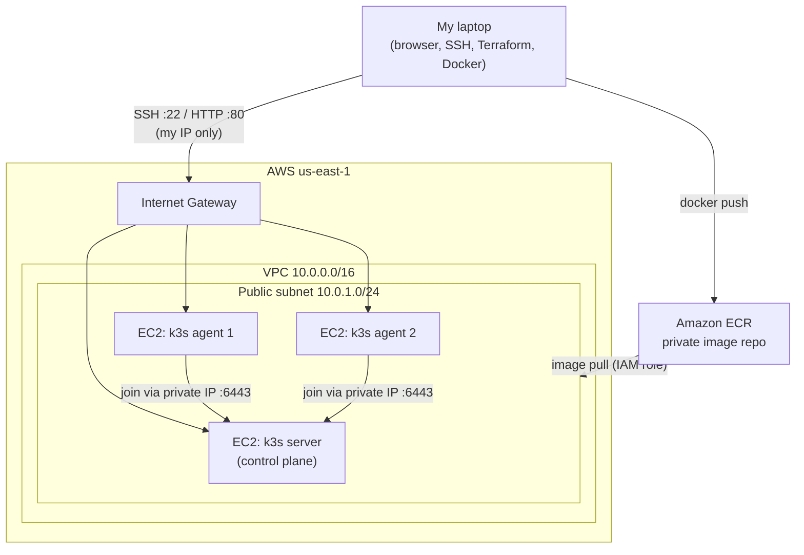

# Kubernetes Cluster Automation on AWS

A 3-node Kubernetes cluster on AWS EC2, built entirely from code with Terraform and Bash. One command builds the network, servers, and cluster; one command tears it all down. A containerized Python API runs on the cluster with load balancing, health checks, rolling updates, and autoscaling.

## Architecture



## Tech Stack

AWS (VPC, EC2, IAM, ECR) · Terraform · Bash (cloud-init) · Kubernetes (k3s) · Docker · Python (Flask, Gunicorn)

## What It Does

- **Terraform** builds a VPC, public subnet, internet gateway, route table, security group, IAM role, ECR repository, and 3 Ubuntu 24.04 EC2 nodes.
- **Bash cloud-init scripts** run at first boot: they patch the OS, log in to ECR using the node's IAM role, and install k3s. Agents wait for the server's API and join the cluster automatically.
- A **Dockerized Python API** (multi-stage build, runs as a non-root user) is stored in private ECR.
- **Kubernetes** runs 3 replicas behind a Service and Ingress, with readiness and liveness health checks, CPU/memory requests and limits, zero-downtime rolling updates, and CPU-based autoscaling (3–10 pods).

## Project Structure

```
├── main.tf              # provider, AMI lookup, security group, key pair, EC2 nodes, join token
├── network.tf           # VPC, subnet, internet gateway, route table
├── iam.tf               # IAM role + instance profile (ECR read-only)
├── ecr.tf               # private image repository (immutable tags, scan on push)
├── variables.tf / outputs.tf
├── cloud-init/          # Bash bootstrap scripts for server and agent nodes
├── app/                 # Flask API + multi-stage Dockerfile
└── k8s/                 # Deployment, Service, Ingress, HorizontalPodAutoscaler
```

## How to Run It

**Prerequisites:** AWS account with CLI access (`aws configure sso`), Terraform, Docker, and an SSH key at `~/.ssh/id_ed25519.pub`.

1. Create `terraform.tfvars` with your public IP:
   ```hcl
   my_ip = "<your-ip>/32"
   ```
2. Build the infrastructure (about 5 minutes for all nodes to be Ready):
   ```bash
   terraform init
   terraform apply
   ```
3. Build and push the image to ECR:
   ```bash
   aws ecr get-login-password --region us-east-1 | docker login --username AWS --password-stdin <ACCOUNT_ID>.dkr.ecr.us-east-1.amazonaws.com
   docker build -t <ACCOUNT_ID>.dkr.ecr.us-east-1.amazonaws.com/k8s-mine-api:v1 app
   docker push <ACCOUNT_ID>.dkr.ecr.us-east-1.amazonaws.com/k8s-mine-api:v1
   ```
4. Deploy the app:
   ```bash
   scp -r k8s ubuntu@<server_public_ip>:~/
   ssh ubuntu@<server_public_ip>
   sudo kubectl apply -f k8s/
   sudo kubectl get pods
   ```
5. Open `http://<server_public_ip>` in a browser. Refreshing shows different pod names as the Service load-balances requests.
6. Tear everything down:
   ```bash
   terraform destroy
   ```

## What I Tested

- **Cluster bootstrap:** `terraform apply` produces 3 nodes in `Ready` state with no manual setup.
- **Load balancing:** the `host` field in the API response changes across refreshes, showing traffic spread across all 3 pods.
- **Self-healing:** deleting a pod causes the Deployment to start a replacement immediately.
- **Rolling update and rollback:** updated v1 → v2 with `kubectl set image`; pods were replaced one at a time (`maxSurge: 1`, `maxUnavailable: 0`), then rolled back with `kubectl rollout undo`.
- **Autoscaling:** a load-generator pod calling the CPU-heavy `/cpu` endpoint pushed CPU above the 50% target, and the HPA scaled the Deployment above 3 replicas, then back down after the load stopped.

## Design Decisions

- **k3s on EC2 instead of EKS:** managing the nodes myself meant handling Linux bootstrapping, patching, and troubleshooting directly. It also avoids the ~$73/month EKS control-plane cost. In production I would use EKS.
- **IAM role instead of access keys:** nodes get temporary credentials from their instance profile, so no AWS keys are stored on any server. The role is limited to ECR read-only access.
- **cloud-init instead of manual setup:** every node configures itself at boot, so the cluster is repeatable and can be rebuilt from scratch with one command.
- **Least-privilege security group:** SSH and HTTP are allowed only from my IP; node-to-node traffic is allowed only between members of the same security group (`self = true`).
- **AMI lookup with an owner filter:** the Ubuntu image is looked up by name and restricted to Canonical's account, so the cluster always uses the latest patched official image and never a lookalike.
- **Immutable image tags:** once `v1` is pushed it can't be overwritten, so every tag maps to exactly one image and rollbacks are reliable.

## Problems I Solved

| Problem | Cause | Fix |
|---|---|---|
| SSH timed out right after `apply` | Instance was still booting | Wait 1–2 minutes; checked instance state, security group, and route table in order |
| `docker login` to ECR returned `400 Bad Request` | Windows PowerShell 5.1 pipes change text encoding | Ran the login through `cmd /c "..."` |
| `terraform apply -target=...` ignored the resource name | PowerShell splits arguments containing `.` and `=` | Quoted the argument: `'-target=aws_ecr_repository.api'` |
| `kubectl apply` said "no objects passed to apply" | YAML files were created but never saved | Saved the files and copied them to the server again |
| `refresh cached SSO token failed` | SSO session expired after ~8 hours | `aws sso login` |
| `Duplicate resource` error | Same resource block defined twice | Kept one definition and added the new attributes to it |

## Known Limitations and Next Steps

- ECR credentials on the nodes expire after 12 hours. Fine for short-lived test clusters; production would use EKS or a credential helper that refreshes them.
- Nodes are in a public subnet to keep costs low. Production would place nodes in private subnets behind a load balancer.
- Terraform state is stored locally. Next step: an S3 backend with locking.
- Next project: a GitHub Actions CI/CD pipeline to build, scan, and deploy automatically.

## Cost and Cleanup

About $0.06/hour while running (3 × t3.small). Always finish with `terraform destroy` and confirm `Destroy complete!`.
